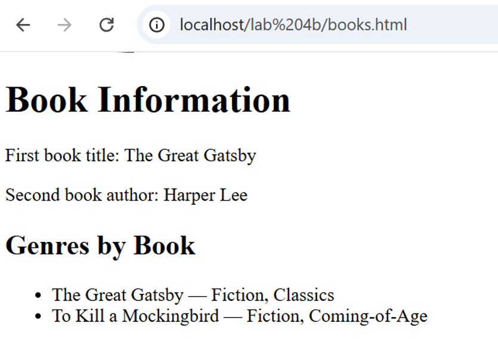

# BIC21203 Web Development - Lab 4

**Name:** KHOR JIA QIAN
**Matric Number:** AI240149

## Overview

This repository contains Lab 4a and Lab 4b for
BIC21203 Web Development.

## Lab 4a: Client-Side Scripting (JavaScript)

### Question 1: Interactive Text Changer
Uses a JavaScript function and click event listener
to change paragraph text.

### Question 2: Smart Number Validator
Uses if...else if...else to validate user input
and compare a number with 10.

### Question 3: Dynamic Number Generator
Uses a for loop and DOM methods to generate
an ordered list from 1 to 5.

## Lab 4b: JSON and jQuery

### Question 1: Create JSON Data
Creates a JSON file containing information about
two books.

### Question 2: Retrieve and Display JSON
Uses fetch() to retrieve book information and
display the titles, author, and genres.

### Question 3: Compare JavaScript and jQuery
Uses jQuery to modify text, add a CSS class,
and handle a button click.

## How to Run Lab 4a

1. Open the Lab4a folder in VS Code.
2. Open the Q1, Q2, or Q3 folder.
3. Open index.html in a web browser.
4. Test the buttons and input fields.

## How to Run Lab 4b

1. Open the Lab4b folder in VS Code.
2. Start Live Server.
3. Open books.html to test JSON retrieval.
4. Open jquery-dom.html to test jQuery.
5. Ensure an internet connection is available
   for the jQuery CDN.

## Lab Screenshots

### Lab 4a - Question 1

### Lab 4a - Question 2

### Lab 4a - Question 3

### Lab 4b - Question 1

### Lab 4b - Question 2

### Lab 4b - Question 3

